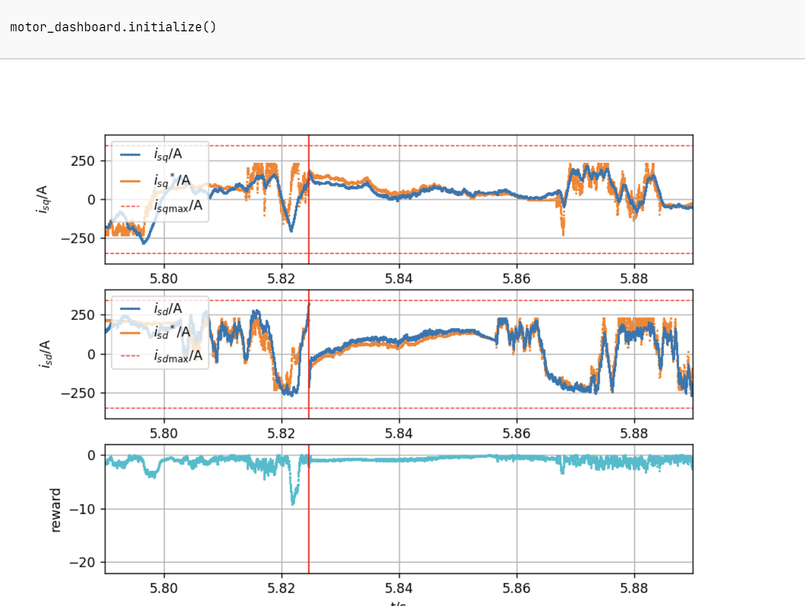
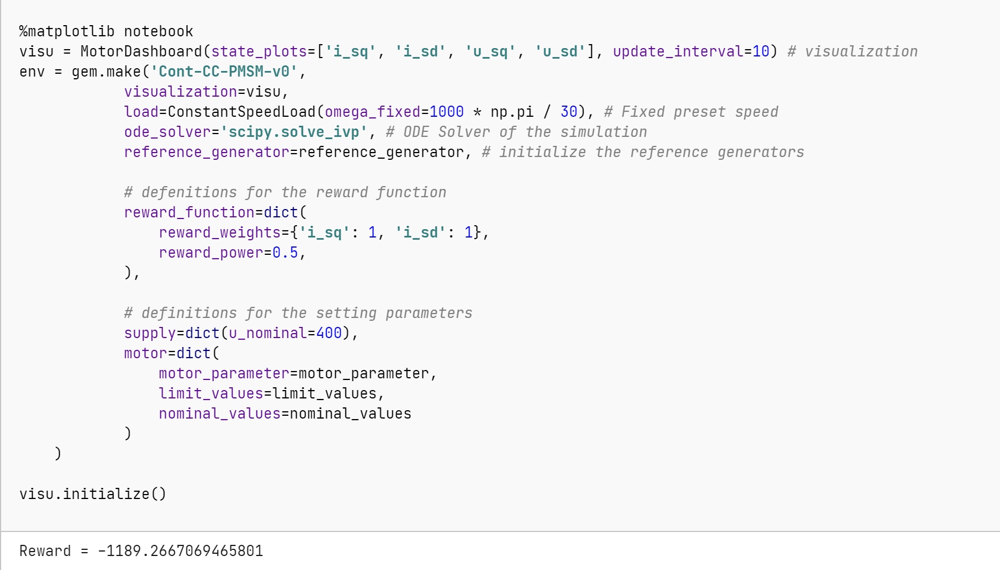
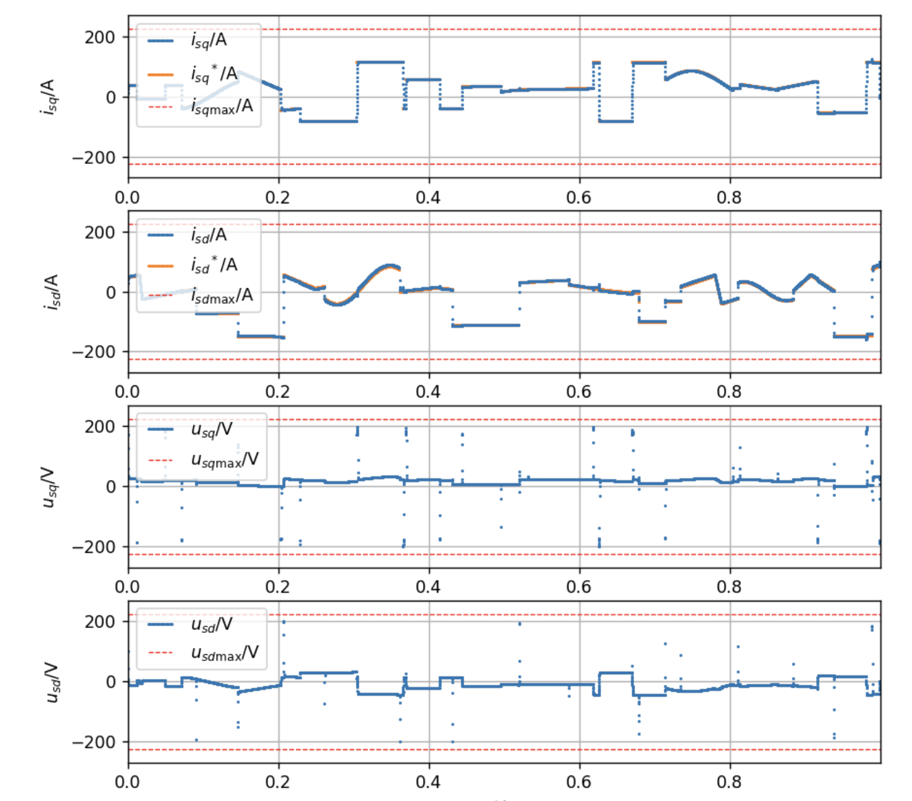
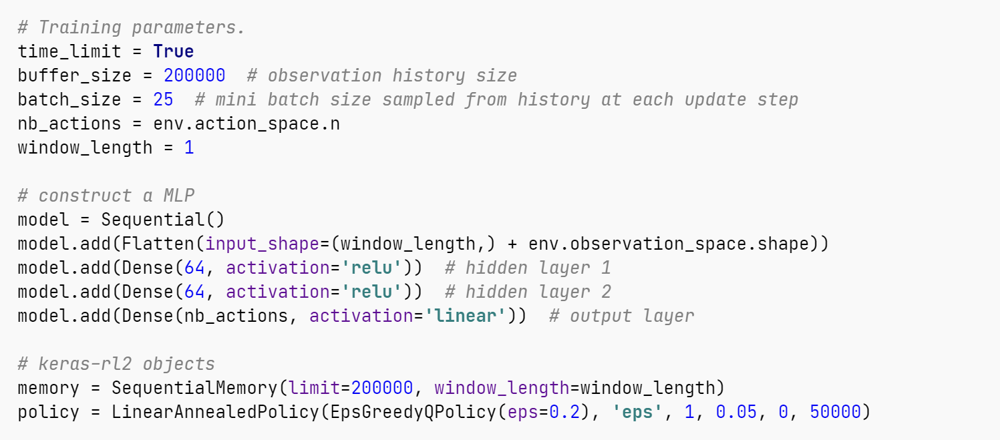
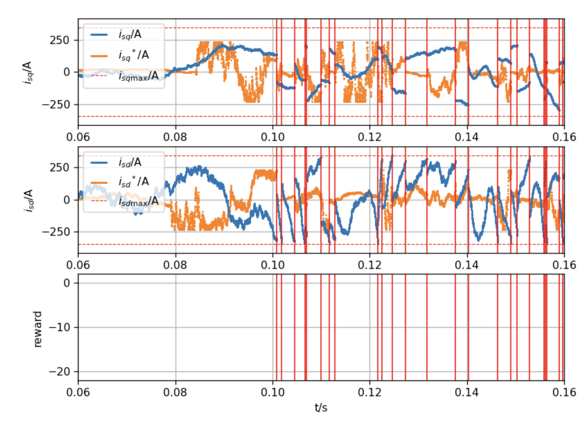
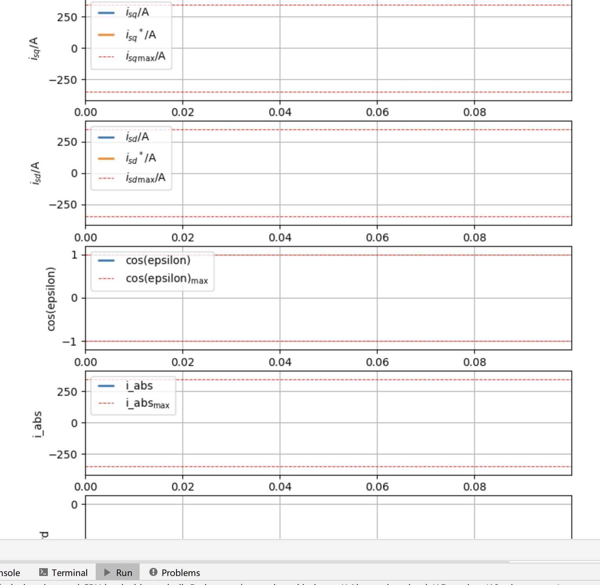

# Research on Motor Control and Power Drive Control Based on a Novel Reinforcement Learning (RL) (Python code implementation)

Research on Motor Control and Electric Drive Control Based on a Novel Reinforcement Learning (RL) (Python code implementation)

## Images

<!-- PAYMENT_BLOCK -->

## Get this dataset

- Payment link (Stripe): [Buy now](https://buy.stripe.com/3cs8yP7sY87d0vu9AB)
- Payment QR code: 

<!-- /PAYMENT_BLOCK -->
